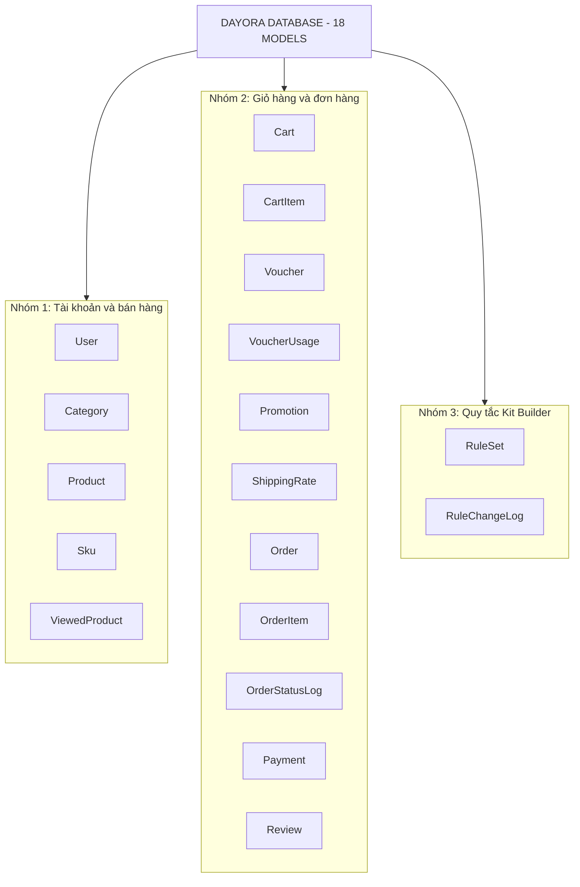
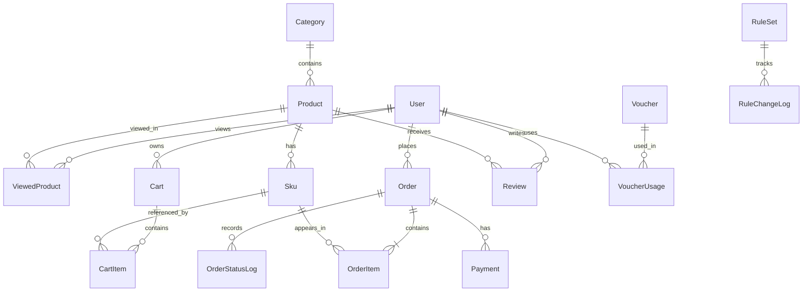

# PRJ-P0-BD2-1.1 — Phân tích mô hình dữ liệu DAYORA

## 1. Tài liệu tham khảo

- docs/DECISIONS.md: Quyết định D06, D07, D08.
- docs/ARCHITECTURE.md: Mục "Dữ liệu chính".

## 2. Phân tích D06 — Giữ tồn kho

Mỗi SKU có hai trường:
- stock: Số lượng tồn kho.
- reserved: Số lượng đang được giữ cho đơn hàng.

Công thức: available = stock - reserved.

Khi tạo đơn, hệ thống kiểm tra số lượng tồn kho khả dụng và tăng reserved trong cùng một database transaction để tránh tình trạng nhiều đơn hàng cùng giữ vượt quá số lượng hàng có thể bán.
Khi thanh toán thành công, hệ thống giảm stock và reserved.
Khi thanh toán thất bại, đơn bị hủy hoặc hết hạn 15 phút, hệ thống giảm reserved để giải phóng hàng.
## 3. Phân tích D07 — Xử lý VNPay IPN đến muộn

IPN là thông báo kết quả thanh toán do VNPay gửi về hệ thống DAYORA.

Khi đơn hàng đã hết hạn nhưng VNPay gửi thông báo thanh toán thành công:

1. Hệ thống xác minh thông báo thanh toán.
2. Kiểm tra giao dịch đã được xử lý hay chưa để tránh xử lý trùng.
3. Nếu còn đủ tồn kho, hệ thống phân bổ lại hàng và xác nhận đơn.
4. Nếu không còn đủ tồn kho, hệ thống ghi nhận đã thanh toán, đánh dấu cần hoàn tiền thủ công và ghi log.
5. Không được trừ tồn kho hai lần cho cùng một giao dịch.

Mục tiêu của D07 là đảm bảo dữ liệu thanh toán, đơn hàng và tồn kho luôn nhất quán.
## 4. Phân tích D08 — Ba trục trạng thái độc lập

Hệ thống DAYORA quản lý đơn hàng bằng ba trường trạng thái:

- `status`: Trạng thái tổng thể của đơn hàng.
- `paymentStatus`: Trạng thái thanh toán.
- `shippingStatus`: Trạng thái vận chuyển.

### Ví dụ trạng thái

| status | paymentStatus | shippingStatus |
|---|---|---|
| PENDING_PAYMENT | UNPAID | NOT_SHIPPED |
| CONFIRMED | PAID | NOT_SHIPPED |
| CONFIRMED | PAID | SHIPPING |
| COMPLETED | PAID | DELIVERED |

Ba trường trạng thái được quản lý độc lập nhưng phải tuân theo quy tắc chuyển trạng thái hợp lệ.

Mỗi lần thay đổi trạng thái cần được ghi nhận trong `OrderStatusLog` để theo dõi lịch sử đơn hàng.

Mục tiêu của D08 là quản lý chính xác quá trình đặt hàng, thanh toán và giao hàng.
## 5. Danh sách 18 model trong cơ sở dữ liệu DAYORA

Hệ thống DAYORA có tổng cộng 18 model, được chia thành 3 nhóm chính.

### Nhóm 1 — Tài khoản và bán hàng (5 model)

1. `User`: Lưu thông tin tài khoản người dùng.
2. `Category`: Lưu danh mục sản phẩm.
3. `Product`: Lưu thông tin sản phẩm.
4. `Sku`: Lưu biến thể sản phẩm, giá và tồn kho.
5. `ViewedProduct`: Lưu lịch sử xem sản phẩm của người dùng.

### Nhóm 2 — Giỏ hàng và đơn hàng (11 model)

1. `Cart`: Lưu thông tin giỏ hàng.
2. `CartItem`: Lưu các sản phẩm trong giỏ hàng.
3. `Voucher`: Lưu mã giảm giá.
4. `VoucherUsage`: Lưu lịch sử sử dụng voucher.
5. `Promotion`: Lưu chương trình khuyến mãi.
6. `ShippingRate`: Lưu mức phí vận chuyển.
7. `Order`: Lưu thông tin đơn hàng.
8. `OrderItem`: Lưu chi tiết từng sản phẩm trong đơn hàng.
9. `OrderStatusLog`: Lưu lịch sử thay đổi trạng thái đơn hàng.
10. `Payment`: Lưu thông tin giao dịch thanh toán.
11. `Review`: Lưu đánh giá sản phẩm.

### Nhóm 3 — Quy tắc Kit Builder (2 model)

1. `RuleSet`: Lưu bộ quy tắc xây dựng kit.
2. `RuleChangeLog`: Lưu lịch sử thay đổi bộ quy tắc.

## Tổng kết

- Nhóm 1: 5 model.
- Nhóm 2: 11 model.
- Nhóm 3: 2 model.

**Tổng cộng: 18 model.**

## 6. Sơ đồ 18 model của DAYORA

Sơ đồ dưới đây thể hiện 18 model được chia thành 3 nhóm dữ liệu chính.

## 7. Sơ đồ quan hệ 1-n giữa các model

Sơ đồ ERD sơ bộ thể hiện các quan hệ quan trọng giữa các model trong cơ sở dữ liệu DAYORA.

### Giải thích các quan hệ

1. **User → ViewedProduct**
   - Một User có thể có 0 đến nhiều ViewedProduct.
   - Mỗi ViewedProduct thuộc đúng một User.

2. **Product → ViewedProduct**
   - Một Product có thể có 0 đến nhiều ViewedProduct.
   - Mỗi ViewedProduct tham chiếu đúng một Product.

3. **Category → Product**
   - Một Category có thể chứa 0 đến nhiều Product.
   - Mỗi Product thuộc đúng một Category (giả định).

4. **Product → Sku**
   - Một Product có thể có 0 đến nhiều Sku.
   - Mỗi Sku thuộc đúng một Product.

5. **User → Cart**
   - Một User có thể có 0 đến nhiều Cart.
   - Mỗi Cart thuộc đúng một User (giả định).

6. **Cart → CartItem**
   - Một Cart có thể chứa 0 đến nhiều CartItem.
   - Mỗi CartItem thuộc đúng một Cart.

7. **Sku → CartItem**
   - Một Sku có thể xuất hiện trong 0 đến nhiều CartItem.
   - Mỗi CartItem tham chiếu đúng một Sku.

8. **User → Order**
   - Một User có thể đặt 0 đến nhiều Order.
   - Mỗi Order thuộc đúng một User (giả định).

9. **Order → OrderItem**
   - Một Order hợp lệ phải có ít nhất một OrderItem (1..n).
   - Mỗi OrderItem thuộc đúng một Order.
   - Không cho phép tạo đơn hàng hợp lệ không có sản phẩm.

10. **Sku → OrderItem**
    - Một Sku có thể xuất hiện trong 0 đến nhiều OrderItem.
    - Mỗi OrderItem tham chiếu đúng một Sku.

11. **Order → OrderStatusLog**
    - Một Order có thể có 0 đến nhiều OrderStatusLog.
    - Mỗi OrderStatusLog thuộc đúng một Order.

12. **Order → Payment**
    - Một Order có thể có 0 đến nhiều Payment.
    - Mỗi Payment thuộc đúng một Order.
    - Giả định: Một đơn hàng có thể có nhiều lần thử thanh toán.

13. **User → Review**
    - Một User có thể viết 0 đến nhiều Review.
    - Mỗi Review thuộc đúng một User.

14. **Product → Review**
    - Một Product có thể nhận 0 đến nhiều Review.
    - Mỗi Review tham chiếu đúng một Product.

15. **Voucher → VoucherUsage**
    - Một Voucher có thể có 0 đến nhiều VoucherUsage.
    - Mỗi VoucherUsage tham chiếu đúng một Voucher.

16. **User → VoucherUsage**
    - Một User có thể có 0 đến nhiều VoucherUsage.
    - Mỗi VoucherUsage thuộc đúng một User.

17. **RuleSet → RuleChangeLog**
    - Một RuleSet có thể có 0 đến nhiều RuleChangeLog.
    - Mỗi RuleChangeLog thuộc đúng một RuleSet.

### Các giả định cần xác nhận

- Mỗi lần xem sản phẩm tạo một ViewedProduct mới hay cập nhật bản ghi cũ?
- Mỗi User chỉ có một Cart đang hoạt động hay có thể có nhiều Cart?
- Một Order có thể có nhiều Payment hay chỉ một Payment?
- Mỗi Product có đúng một Category hay được phép thuộc nhiều Category?
- Review có bắt buộc gắn với đơn hàng đã mua không?
- VoucherUsage có liên kết trực tiếp với Order không?
- Promotion và ShippingRate có quan hệ khóa ngoại trực tiếp với các model khác không?
- Các quan hệ và khóa ngoại cần được đối chiếu với Prisma Schema trước khi chốt thiết kế.

**Lưu ý:** Đây là ERD sơ bộ. Sơ đồ có 16 model tham gia quan hệ; Promotion và ShippingRate chưa được nối vì chưa xác nhận khóa ngoại. Sơ đồ nhóm ở mục 6 vẫn thể hiện đầy đủ 18 model.
