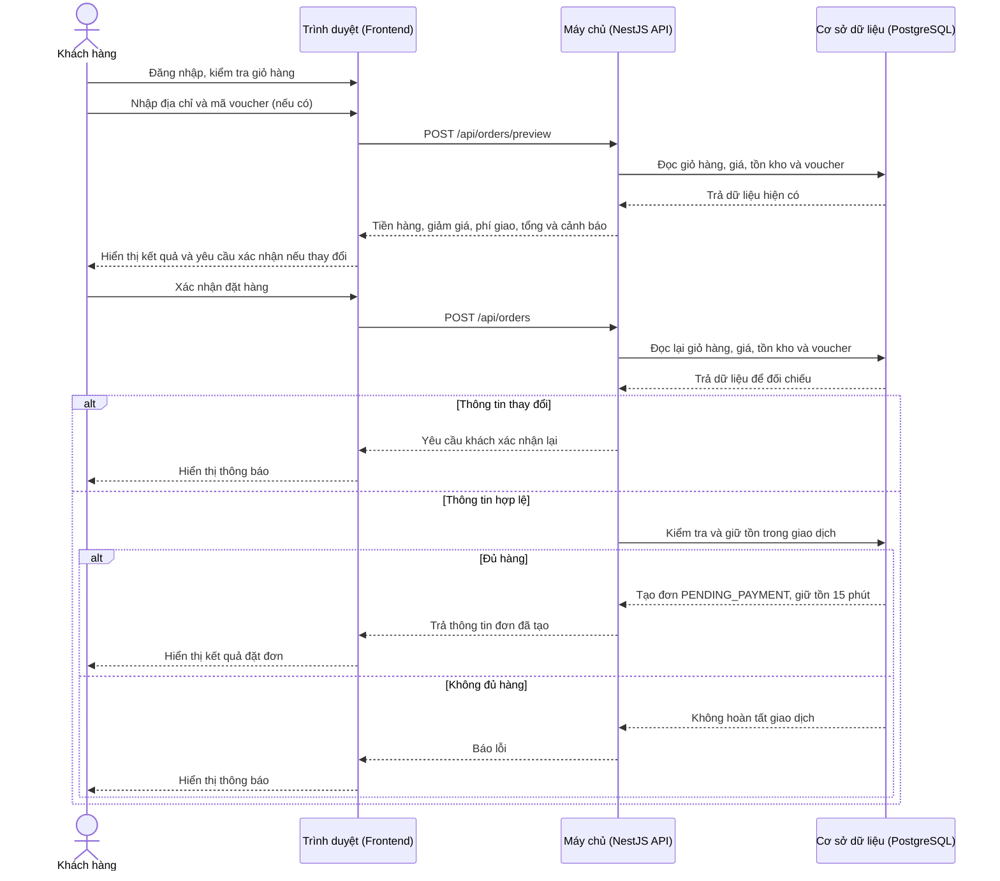

# Chương 3 · Giỏ hàng, checkout và voucher

## 1. Luồng đặt hàng (Checkout Flow)

Luồng dưới đây mô tả yêu cầu của bước PRJ-P2-PM-1.1 và đối chiếu với mã nguồn hiện có. D04 và D06 hiện vẫn có trạng thái **đề xuất** trong [DECISIONS.md](../DECISIONS.md); việc sử dụng chúng ở đây không có nghĩa nhóm đã chính thức chốt.

1. **Xem giỏ hàng:** Khách kiểm tra sản phẩm, số lượng và đơn giá tạm tính. Giỏ hàng và checkout yêu cầu đăng nhập theo phương án D04.
2. **Nhập thông tin giao hàng:** Khách nhập thông tin người nhận, địa chỉ và chọn khu vực giao hàng: nội thành TP.HCM, ngoại thành TP.HCM hoặc tỉnh/thành khác. Thông tin được dùng để xác định phí giao.
3. **Áp dụng mã ưu đãi:** Khách có thể nhập một mã voucher, ví dụ `DAYORA10` hoặc `PICNIC50K`. Máy chủ kiểm tra mã và điều kiện áp dụng; tên mã trong ví dụ không xác nhận mã đang có hiệu lực.
4. **Xem trước đơn:** Trình duyệt gửi `POST /api/orders/preview` (đường dẫn `/orders/preview` dưới tiền tố `/api`). Máy chủ đọc dữ liệu cần thiết, tính lại tiền hàng, mức giảm, phí giao và tổng tiền rồi trả kết quả cùng cảnh báo nếu có. Nếu thông tin thay đổi, khách cần xem và xác nhận lại trước khi chốt đơn.
5. **Xác nhận đặt đơn:** Khách bấm đặt hàng, trình duyệt gửi `POST /api/orders`. Máy chủ tính và kiểm tra lại giỏ hàng, giá, voucher, phí giao và số lượng khả dụng. Nếu hợp lệ, trong giao dịch cơ sở dữ liệu, hệ thống kiểm tra `stock - reserved >= quantity`, tăng `reserved`, tạo đơn trạng thái `PENDING_PAYMENT`, lưu thông tin đơn đã chốt và đặt thời hạn giữ tồn 15 phút theo phương án D06. Nếu dữ liệu thay đổi hoặc hàng không đủ, hệ thống báo lỗi thay vì xác nhận thành công.

### Sơ đồ luồng

Đối chiếu mã nguồn: [orders.controller.ts](../../apps/api/src/orders/orders.controller.ts), [orders.service.ts](../../apps/api/src/orders/orders.service.ts), [checkout.service.ts](../../apps/api/src/orders/checkout.service.ts) và [CheckoutPage.tsx](../../apps/web/src/pages/CheckoutPage.tsx). Đây là tài liệu mô tả; chưa xác nhận kết quả chạy hoặc nghiệm thu thực tế trong lượt soạn thảo này.

## 2. Quy tắc voucher và phí giao

Các quy tắc dưới đây đối chiếu với D02, D03 trong [DECISIONS.md](../DECISIONS.md) và [mã tính giá](../../apps/api/src/pricing/pricing.ts). D02 và D03 hiện vẫn được ghi là **đề xuất**; tài liệu này không tự xác nhận nhóm đã chốt.

### 2.1. Điều kiện áp dụng voucher

Máy chủ chỉ áp dụng voucher khi đáp ứng các điều kiện sau. Trường thời gian trong code là `startsAt` và `endsAt`.

| # | Điều kiện | Thông tin kiểm tra | Khi không đáp ứng |
|---|---|---|---|
| 1 | Mã tồn tại và đang được kích hoạt | `code`, `isActive` | Voucher không hợp lệ hoặc không hoạt động; không áp dụng giảm giá. |
| 2 | Đang trong thời gian hiệu lực | `startsAt`, `endsAt` | Báo voucher ngoài hạn hiệu lực. Theo code, thời điểm dùng phải từ `startsAt` trở đi và trước `endsAt`. |
| 3 | Còn lượt dùng toàn hệ thống, nếu mã có giới hạn | `usageLimit`, số lượt `VoucherUsage` | Báo voucher hết lượt khi số lượt đã dùng đạt giới hạn. |
| 4 | Khách còn lượt dùng cá nhân, nếu mã có giới hạn | `perUserLimit`, số lượt `VoucherUsage` của khách | Báo voucher hết lượt của khách; nếu giới hạn là một thì khách không được dùng lại khi đã đạt một lượt. |
| 5 | Tiền hàng sau giá sale đạt mức tối thiểu của voucher | `minOrderValue`, `subtotal` | Báo chưa đạt giá trị đơn tối thiểu. |
| 6 | Mỗi đơn chỉ sử dụng tối đa một voucher | Trường `voucherCode` của yêu cầu đặt hàng; D03 | Không cộng dồn nhiều mã cho cùng một đơn. |

Số lượt đã dùng được tính từ các bản ghi `VoucherUsage`; không giả định `usedCount` là một cột lưu trực tiếp trong bảng voucher. Nếu không cấu hình một giới hạn lượt hoặc mức tối thiểu, code xử lý giá trị tương ứng theo quy định của nó. Với voucher không hợp lệ, khách cần kiểm tra lại hoặc bỏ mã trước khi tạo đơn; việc ghi nhận thông báo ở đây chưa thay thế kiểm thử giao diện.

### 2.2. Tính tiền và phí giao

Tiền hàng được tính theo giá hiện hành sau sale của từng SKU nhân số lượng. Mỗi đơn dùng tối đa một voucher; mức giảm tính trên tiền hàng, không tính trên phí giao. Với voucher phần trăm, số tiền giảm được làm tròn xuống và bị giới hạn theo `maxDiscount` nếu có; mức giảm không vượt tiền hàng.

**Tổng thanh toán = tiền hàng sau sale − giảm voucher + phí giao.**

| Khu vực giao hàng | Phí giao thông thường |
|---|---:|
| Nội thành TP.HCM | 20.000đ |
| Ngoại thành TP.HCM | 30.000đ |
| Tỉnh/thành khác | 40.000đ |

Miễn phí giao cho đơn giao **nội hoặc ngoại thành TP.HCM** khi tiền hàng sau giảm voucher từ **500.000đ** trở lên. Tỉnh/thành khác không thuộc điều kiện miễn phí này. Khi chưa xác định khu vực, phí giao tạm tính là 30.000đ.

### 2.3. Ví dụ tính tiền

Các ví dụ giả sử mã còn hiệu lực, khách còn lượt, đơn thỏa các điều kiện áp dụng và không có ưu đãi nào khác. Chúng minh họa phép tính, không xác nhận trạng thái voucher trong cơ sở dữ liệu tại thời điểm xem.

**Ví dụ 1 — DAYORA10, giao nội thành TP.HCM:**

- Bốn bình nước có tổng tiền hàng 400.000đ; giả sử voucher giảm 10% và không vượt trần giảm.
- Giảm voucher: 400.000đ × 10% = **40.000đ**.
- Tiền hàng sau giảm: 400.000đ − 40.000đ = **360.000đ**, dưới ngưỡng miễn phí giao.
- Phí giao nội thành: **20.000đ**. Tổng thanh toán: 360.000đ + 20.000đ = **380.000đ**.

**Ví dụ 2 — PICNIC50K, giao ngoại thành TP.HCM:**

- Tiền hàng: 600.000đ; giả sử voucher giảm cố định **50.000đ**.
- Tiền hàng sau giảm: 600.000đ − 50.000đ = **550.000đ**.
- 550.000đ ≥ 500.000đ và địa chỉ thuộc TP.HCM nên phí giao là **0đ**.
- Tổng thanh toán: 550.000đ + 0đ = **550.000đ**.

## 3. Bảo mật định giá và tranh chấp tồn kho

Sẽ bổ sung ở bước tiếp theo của task.
