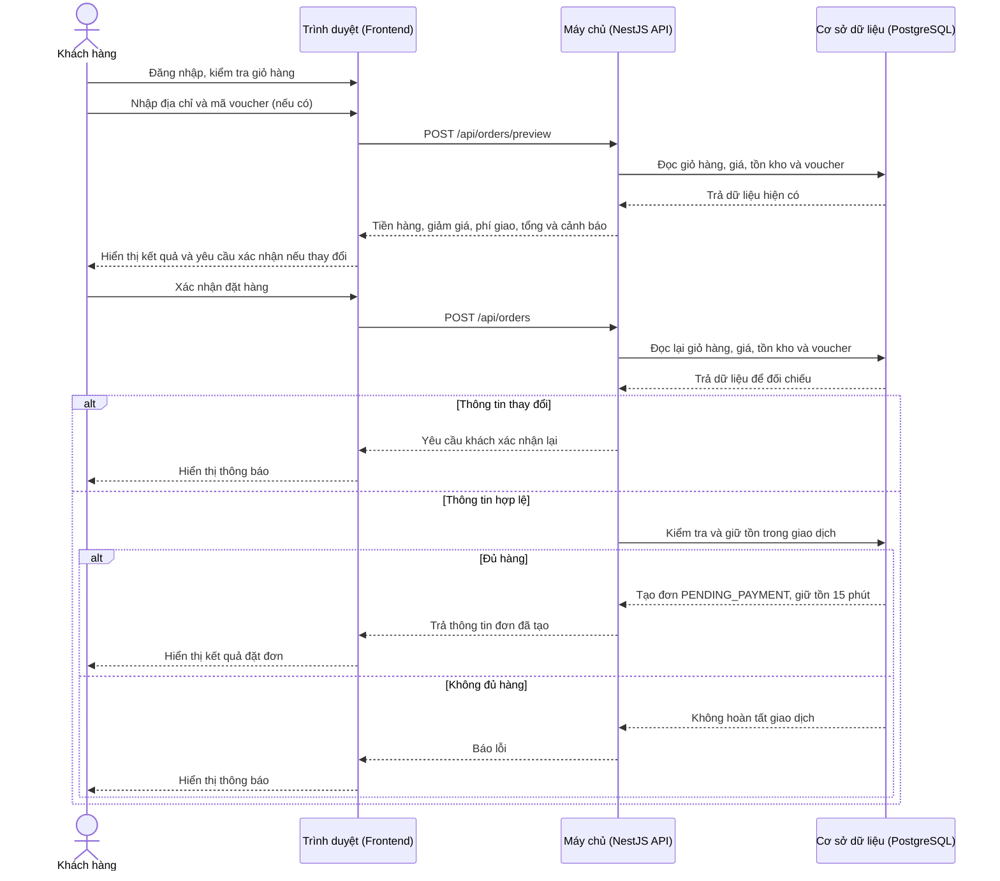

# Chương 3 · Giỏ hàng, checkout và voucher

## 1. Luồng đặt hàng (Checkout Flow)

Luồng dưới đây mô tả yêu cầu của bước PRJ-P2-PM-1.1 và đối chiếu với mã nguồn hiện có. D04 và D06 hiện vẫn có trạng thái **đề xuất** trong [DECISIONS.md](../DECISIONS.md); việc sử dụng chúng ở đây không có nghĩa nhóm đã chính thức chốt.

1. **Xem giỏ hàng:** Khách kiểm tra sản phẩm, số lượng và đơn giá tạm tính. Giỏ hàng và checkout yêu cầu đăng nhập theo phương án D04.
2. **Nhập thông tin giao hàng:** Khách nhập thông tin người nhận, địa chỉ và chọn khu vực giao hàng: nội thành TP.HCM, ngoại thành TP.HCM hoặc tỉnh/thành khác. Thông tin được dùng để xác định phí giao.
3. **Áp dụng mã ưu đãi:** Khách có thể nhập một mã voucher, ví dụ `DAYORA10` hoặc `PICNIC50K`. Máy chủ kiểm tra mã và điều kiện áp dụng; tên mã trong ví dụ không xác nhận mã đang có hiệu lực.
4. **Xem trước đơn:** Trình duyệt gửi `POST /api/orders/preview` (đường dẫn `/orders/preview` dưới tiền tố `/api`). Máy chủ đọc dữ liệu cần thiết, tính lại tiền hàng, mức giảm, phí giao và tổng tiền rồi trả kết quả cùng cảnh báo nếu có. Nếu thông tin thay đổi, khách cần xem và xác nhận lại trước khi chốt đơn.
5. **Xác nhận đặt đơn:** Khách bấm đặt hàng, trình duyệt gửi `POST /api/orders`. Máy chủ tính và kiểm tra lại giỏ hàng, giá, voucher, phí giao và số lượng khả dụng. Nếu hợp lệ, trong giao dịch cơ sở dữ liệu, hệ thống kiểm tra `stock - reserved >= quantity`, tăng `reserved`, tạo đơn trạng thái `PENDING_PAYMENT`, lưu thông tin đơn đã chốt và đặt thời hạn giữ tồn 15 phút theo phương án D06. Nếu dữ liệu thay đổi hoặc hàng không đủ, hệ thống báo lỗi thay vì xác nhận thành công.

### Sơ đồ luồng

Đối chiếu mã nguồn: [orders.controller.ts](../../apps/api/src/orders/orders.controller.ts), [orders.service.ts](../../apps/api/src/orders/orders.service.ts), [checkout.service.ts](../../apps/api/src/orders/checkout.service.ts) và [CheckoutPage.tsx](../../apps/web/src/pages/CheckoutPage.tsx). Đây là tài liệu mô tả; chưa xác nhận kết quả chạy hoặc nghiệm thu thực tế trong lượt soạn thảo này.

## 2. Quy tắc voucher và phí giao

Sẽ bổ sung ở bước PRJ-P2-PM-1.2.

## 3. Bảo mật định giá và tranh chấp tồn kho

Sẽ bổ sung ở bước tiếp theo của task.
